<div align="center">

# N O T H I N G

**A Nothing OS desktop for KDE Plasma 6 — dot matrix, greyscale, one red interrupt.**

Built and daily-driven on Kubuntu · Plasma 6.6 · Wayland

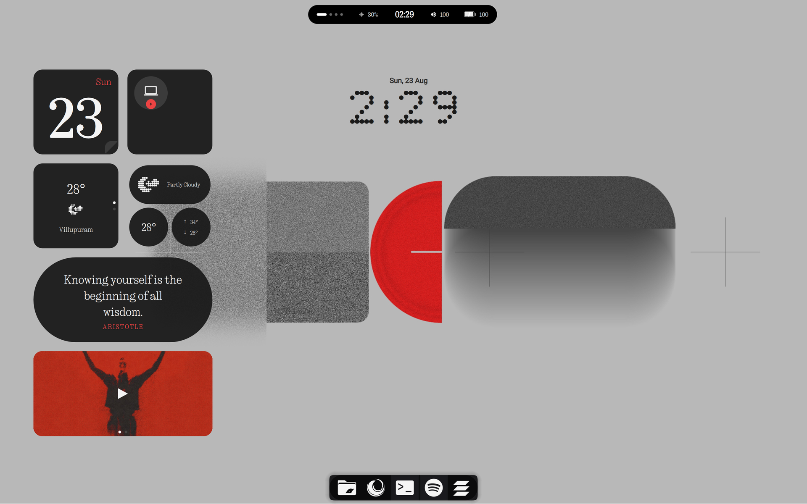

</div>

---

Most "Nothing" ports stop at a dark colour scheme. This one goes end to end — the
boot splash, the login screen, the login *fonts*, the panels, the widget grid and
the window compositing all follow the same rules, so there is no moment during
startup where the illusion breaks.

Everything here is scripted and reversible. `./install.sh` on a fresh Kubuntu box
gets you the screenshot above.

---

## The dynamic island

<div align="center">
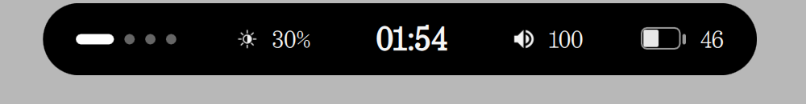
</div>

A floating top panel only as wide as its contents. The left cluster is a **virtual
desktop pager** — current desktop is a pill, the others are dots. Then brightness,
clock, volume, battery.

Click it and it grows into a control surface. Click any of the cards on that
surface and **the pill grows again** into a full picker — the island never opens a
second window.

<table>
<tr>
<td width="50%" valign="top" align="center">
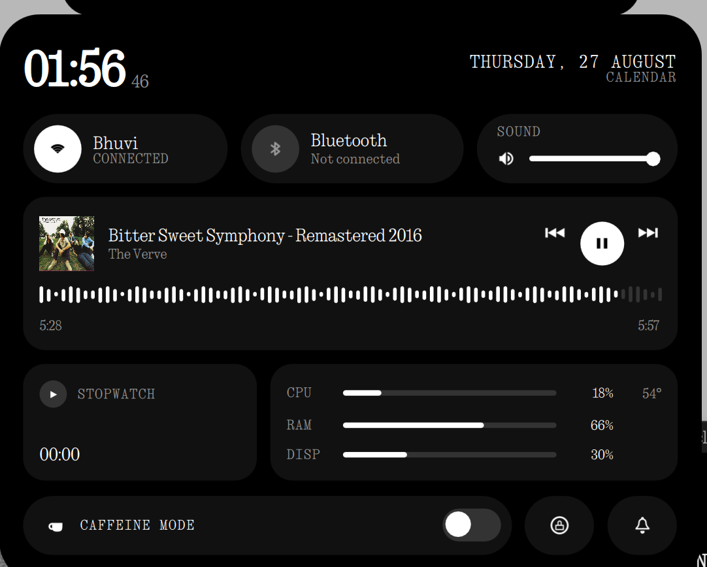<br>
<sub><b>The panel.</b> Media with a scrubable waveform, network and Bluetooth,
volume, CPU/RAM/brightness bars, stopwatch, caffeine, DND, lock.</sub>
</td>
<td width="50%" valign="top" align="center">
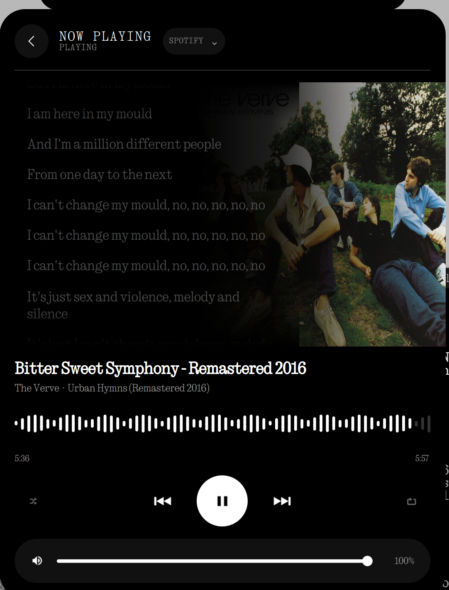<br>
<sub><b>Now playing.</b> Cover bleeds off the right edge under a gradient;
time-synced lyrics scroll up the black half. Tap a line to seek to it.</sub>
</td>
</tr>
<tr>
<td width="50%" valign="top" align="center">
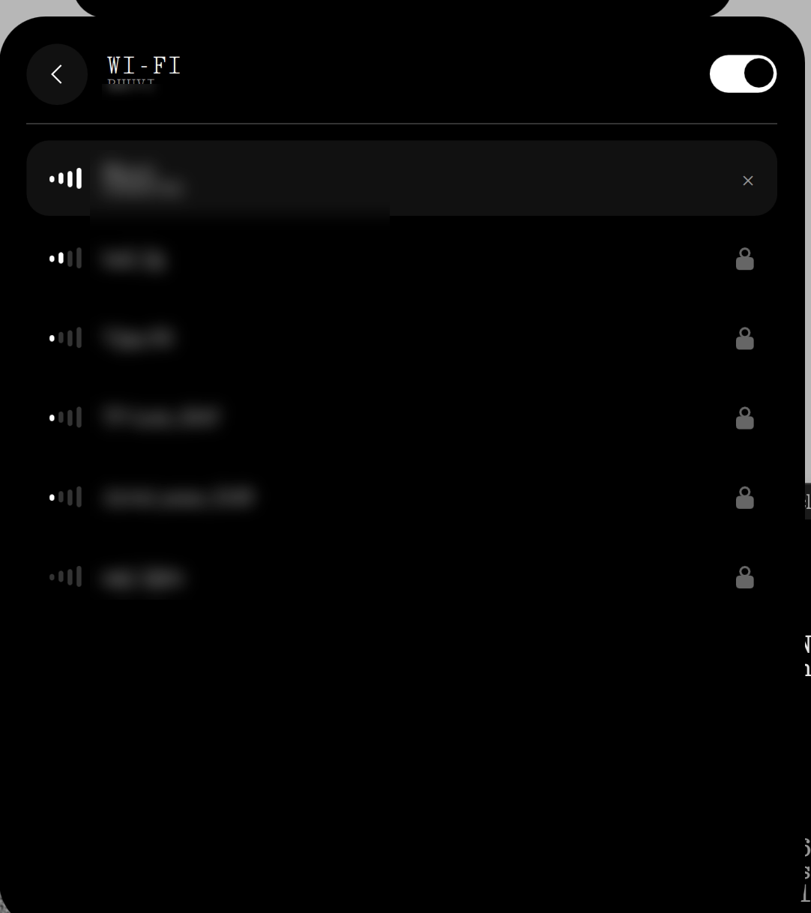<br>
<sub><b>Wi-Fi.</b> Live scan, signal bars, radio toggle. Tap a secured network and
the sheet turns into a password screen. Network names blurred for the screenshot.</sub>
</td>
<td width="50%" valign="top" align="center">
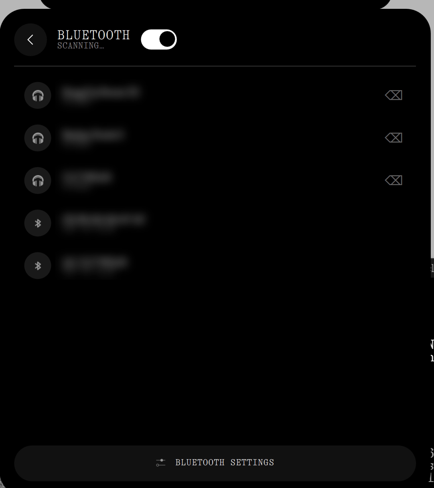<br>
<sub><b>Bluetooth.</b> Paired and discovered devices, tap to connect, tap an
unknown one to pair. Device names blurred for the screenshot.</sub>
</td>
</tr>
</table>

Joining a network goes through `PlasmaNM.Handler` — the same object plasma-nm's
own applet uses — so saved profiles, the kded secret agent and enterprise networks
all still work. Pairing calls `org.bluez.Device1.Pair` directly rather than driving
`bluetoothctl`, which would register a competing agent and steal bluedevil's PIN
dialog.

## The app drawer

<div align="center">
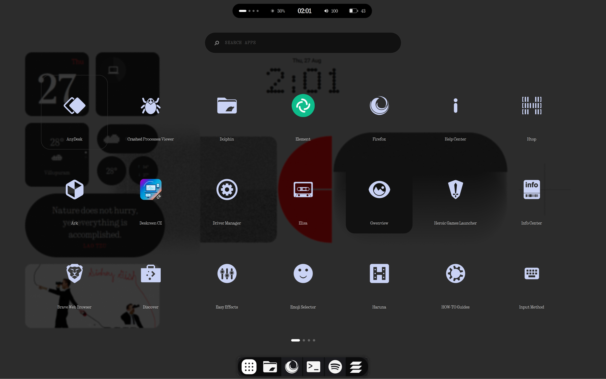
</div>

Full screen, translucent, blurred over the live desktop — Launchpad's footprint in
Nothing's language. Paged sideways with a morphing page indicator that matches the
island's desktop pager. Type anywhere to search; search flips the grid back to
normal reading order because a ranked list has an order.

<div align="center">
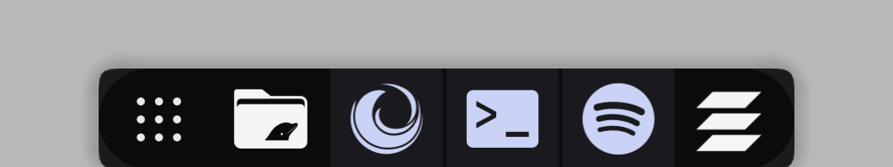<br>
<sub>The dot-matrix start button, at the left of the dock.</sub>
</div>

**The Meta key opens it.** No shortcut is changed to make that happen: Plasma
already binds `activate application launcher` to Meta, and had no applet claiming
it. The package declares `X-Plasma-Provides: org.kde.plasma.launchermenu`, which is
the whole trick.

## Three-finger window gestures

| Gesture | Does |
|---|---|
| Three fingers **down** | minimise the active window, focus the one underneath |
| Three fingers **up** | bring the last one back and focus it |

Exact inverses while you keep swiping. The window animates on the way out and back
— KWin's `squash` effect plays on both, and the monochrome-inactive effect below
fades the newly focused window from grey back to colour — with no on-screen notice,
because a gesture you make dozens of times a day should not announce itself.

If you would rather it did, `SHOW_OSD` at the top of
`kwin/scripts/nothing-window-cycle/contents/code/main.js` puts a Nothing-styled OSD
up naming the window, with the arrow pointing the way your fingers went.

Three-finger **left/right** still switches virtual desktops: a swipe must be 1.5×
more vertical than horizontal to count, which keeps the two apart.

## The Glyph

<div align="center">
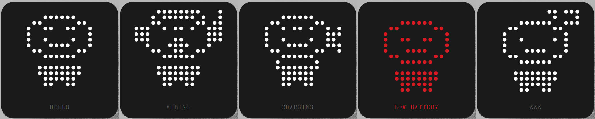
</div>

A dot-matrix character on a 16x16 grid that reacts to what the machine is doing.
Headphones and a bob when music plays, a bolt when it is charging, a slump and a
red wash under 15 %, zeds after 23:00. Tap it to cycle the poses.

Every input is event-driven — MPRIS, PowerDevil, and a one-minute clock tick.
Nothing here polls a subprocess: the widget sits on the desktop all day, and the
island's own audit showed how fast a 2-second shell poll turns into 4 % of a core.

Poses are assembled from parts — head, torso, eyes, mouth, arms, props — so the
five states share one character instead of being five drawings that drift apart.
Adding another is a few lines in `Glyph.js`.

## The widget grid

<table>
<tr>
<td width="58%" valign="top" align="center">
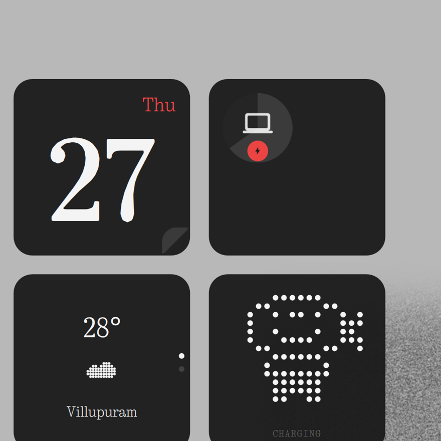
</td>
<td width="42%" valign="top" align="center">
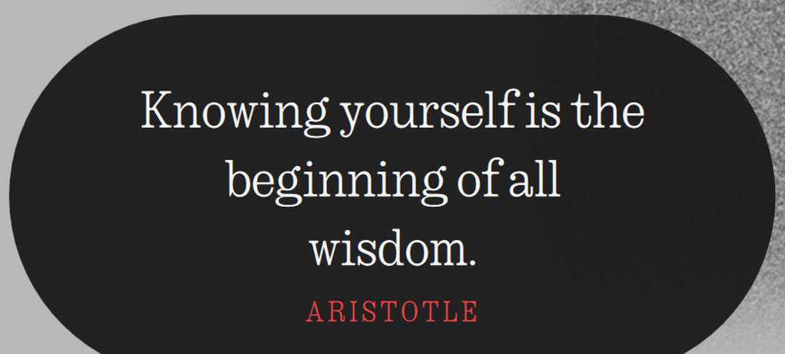
</td>
</tr>
</table>

Date, battery, weather, the Glyph, quote of the day and now-playing on a strict
208 px grid, with the big dot-matrix clock to the right of it as the one focal
element.

---

## What you get

| Layer | What it is | Where it comes from |
|---|---|---|
| Boot + shutdown splash | 60-frame dot-matrix ripple, seamless loop at 30 Hz | **this repo** |
| Login screen | SDDM theme, dot-matrix clock, bare username/password | **this repo** |
| Dynamic island | Original plasmoid — pager, stats, media, Wi-Fi, Bluetooth, lyrics | **this repo** |
| App drawer | Original plasmoid — full-screen paged launcher on the Meta key | **this repo** |
| Window gestures | KWin script + libinput watcher, three-finger up/down | **this repo** |
| Widget reload on network-up | Systemd user service, fixes empty widgets after login | **this repo** |
| Glyph | Original plasmoid — dot-matrix character that reacts to what you are doing | **this repo** |
| Quote of the day | Original plasmoid — 65 quotes, one a day | **this repo** |
| Inactive windows | KWin effect: unfocused windows drain to greyscale | **this repo** |
| Terminal | Konsole `Nothing` profile + colour scheme | **this repo** |
| Panels | Floating island + dock, black pills via Panel Colorizer | scripted here |
| Global theme, icons, cursor, wallpapers | Nothing 1.8, YAMIS, WhiteSur | fetched from store.kde.org |
| Desktop widgets | Nothing KDE Widgets | fetched from GitHub |
| Fonts | NType 82, Ndot 55, Nothing Font (5×7) | bundled with the widget pack |

This repo deliberately **does not redistribute** Nothing's fonts, the KDE-store
themes or the wallpapers. `install/20-upstream.sh` fetches them from their authors
so the licences stay with them.

---

## Quick start

Kubuntu 24.04+ (or Ubuntu with the `kubuntu-desktop` task), Plasma **6**, Wayland or X11.

```bash
git clone https://github.com/buddi0812/nothing-kde-rice
cd nothing-kde-rice
./install.sh
```

That runs the four user-level steps. Then the two that need root:

```bash
sudo ./install/50-login-screen.sh     # SDDM
sudo ./install/60-boot-animation.sh   # Plymouth
```

Log out and back in. Reboot to see the boot splash.

> **Heads up:** step 4 removes every existing panel — that is the point, it rebuilds
> them. Your old layout is copied to `~/.nothing-rice-backups/` first, and
> `uninstall/revert-desktop.sh` puts it back.

### Running steps individually

Every step is idempotent and standalone:

```bash
./install.sh 40          # just rebuild the panels and widget grid
./install.sh all         # everything including the sudo steps
```

| Step | Does | Root? |
|---|---|---|
| `10-packages` | apt packages | sudo for apt |
| `20-upstream` | widgets, fonts, store themes, wallpapers | no |
| `30-components` | plasmoids, KWin effect + script, gestures, net-reload, Konsole, appearance | no |
| `40-layout` | panels + desktop widget grid | no |
| `50-login-screen` | SDDM theme + system-wide fonts | **yes** |
| `60-boot-animation` | Plymouth theme + initramfs | **yes** |

### The gestures need one group membership

Reading the touchpad needs the `input` group:

```bash
id -nG | grep -q input || sudo gpasswd -a "$USER" input   # then log out and back in
```

Understand the trade: membership lets **any** process you run read every input
device, keyboard included. Everything else in this repo works without it — if you
skip this, only the three-finger gestures are lost.

---

## Things worth knowing before you start

**The weather widget defaults to Villupuram.** That is the widget author's own
default, not a bug. Right-click → Configure.

**The window decoration is optional.** The titlebars in the screenshots are
[Klassy](https://github.com/paulmcauley/klassy), which is not in the Ubuntu archive
and has to be built. Skip it and KWin falls back to Breeze, which still looks fine.

**Do not re-apply the Nothing Global Theme with "use desktop layout" ticked.**
It wipes the panels *and* the desktop widgets. If it happens, `./install.sh 40`
rebuilds everything.

**The desktop containment must be Folder View** for the widget grid to snap to
208 px cells. That is the Kubuntu default.

**Lyrics come from [LRCLIB](https://lrclib.net)** and are fetched only while the
now-playing sheet is open, then cached for the session. No key, no account. Not
every track is in the database.

---

## What's in here

```
├── install.sh                  orchestrator
├── install/
│   ├── lib.sh                  shared helpers, KDE-store OCS downloader
│   ├── 10-packages.sh          apt
│   ├── 20-upstream.sh          widgets, fonts, store themes, wallpapers
│   ├── 30-components.sh        plasmoids, KWin effect + script, services, appearance
│   ├── 40-layout.sh            panels + desktop widget grid
│   ├── 50-login-screen.sh      SDDM            (sudo)
│   └── 60-boot-animation.sh    Plymouth        (sudo)
├── plasmoids/
│   ├── com.dev08.nothingdynamicisland/
│   ├── com.dev08.nothingappdrawer/
│   ├── com.dev08.nothingglyph/
│   └── com.dev08.nothingquote/
├── kwin/
│   ├── effects/nothing-monochrome-inactive/
│   └── scripts/nothing-window-cycle/
├── services/                   nothing-gestures, nothing-net-reload (+ units, configs)
├── sddm/Nothing/
├── plymouth/nothing/           60 frames + make-frames.py
├── konsole/                    Nothing profile + colour scheme
├── panel-colorizer/            the two panel-background presets
├── uninstall/revert-desktop.sh
└── docs/
    ├── ENGINEERING-LOG.md      how each piece was built, and what broke
    └── TROUBLESHOOTING.md      every failure mode hit so far, with fixes
```

---

## The custom pieces

### Dynamic island — `com.dev08.nothingdynamicisland`

The reference desktop's island is unreleased, so this is an original
implementation. It avoids the fragile QML sensor APIs entirely: a `stats.sh`
subprocess emits `\x1f`-separated key=value pairs and the QML parses them.

That script runs in **two tiers**, because the compact pill is on screen almost
always and the panel almost never. Closed, it asks for volume and brightness only —
28 ms every 3 s. Open, it adds CPU, memory, temperature, `nmcli` and `bluetoothctl`
— 89 ms every 2 s. Polling everything all the time cost ~4.4 % of a core, forever.

The same rule shapes the rest: `PlasmaNM.NetworkModel` and `BluezQt.Manager` are
built inside the sheets that use them, never at applet scope, because the first
subscribes to every access point's signal-strength updates and the second starts a
BlueZ client the instant it is *referenced*.

The popup window is a fixed size and never resizes — only the black pill inside it
animates. Animating a Wayland surface's size renegotiates its buffer every frame
and visibly stutters.

### App drawer — `com.dev08.nothingappdrawer`

Built on `Kicker.DashboardWindow`, the same primitive as KDE's own Application
Dashboard, so it is genuinely full screen with real blur-behind rather than a
dialog pretending. Apps come from `Kicker.RootModel`; the all-apps child model is
found by `description === "KICKER_ALL_MODEL"`, not by a fixed row.

Paging is Launchpad's: `flow: GridView.FlowTopToBottom` with cells dividing the
viewport exactly, so one viewport width is exactly one page and snapping is
arithmetic. Opening and closing are separate flags so the window survives its own
exit animation.

### Window gestures — `nothing-window-cycle` + `nothing-gestures`

Two pieces, because one cannot do it alone. **KWin cannot bind a touchpad swipe
from a script**: `EffectsHandler::registerTouchpadSwipeShortcut()` exists in C++,
but the JS API exposes only `registerShortcut` and the screen-edge calls, for
scripts and scripted effects alike. Nothing on KWin's D-Bus either, and Plasma 6.6
ships no gestures KCM.

So a KWin script registers two global shortcuts with no default key, and a small
watcher reads `libinput debug-events` and invokes them over kglobalaccel's D-Bus
interface. The script resolves the next window to focus *before* minimising, since
KWin refocuses on its own the moment the active window goes away.

Thresholds were measured, not guessed — `nothing-gestures --calibrate` prints what
your own swipes accumulate and changes nothing.

### Widget reload on network-up — `nothing-net-reload`

Several widgets fetch exactly once from `Component.onCompleted` — the weather
widget geocodes once and never retries — and at login plasmashell is up seconds
before Wi-Fi associates, so they sit empty until something restarts the shell.

Plasma has no per-applet reload in its scripting API and no D-Bus call for one, so
this watches NetworkManager and restarts `plasma-plasmashell.service` on a genuine
offline→online edge, debounced and rate-limited. Online is read as a *number* off
NetworkManager's D-Bus properties; `nmcli`'s connectivity strings are translated.

### Glyph — `com.dev08.nothingglyph`

Sits in the grid slot the second weather widget used to hold; the weather card
beside it already carries the temperature and the condition.

Two things only became obvious by rendering it rather than reasoning about it.
An **outlined** head reads as a face at 16x16 — a filled blob with the eyes
punched out reads as three vertical bars. And the head and torso need a blank row
between them: joined by a neck they merge into one mass and it stops reading as a
figure at all.

The card is deliberately not styled to taste. It matches the widgets sharing the
grid exactly — inset 10, radius 20, `#1a1a1a` at 95 % opacity — because anything
else makes the cell look bigger and a different black than its neighbours.

### Quote of the day — `com.dev08.nothingquote`

65 short quotes, one per day, picked by *local* day number —
`Date.UTC(y,m,d)/86400000` rather than `Date.now()/86400000`, which would roll over
at UTC midnight instead of yours. Click it to step through the set.

### Monochrome inactive windows — KWin effect

Unfocused windows drain to greyscale instead of going translucent, so they stay
readable over the light wallpaper while still reading as "not here".

The interesting part is what it must *not* do. A held `set()` animation takes a
visibility reference that **outranks the hide minimising relies on** — animate a
minimised window and it never leaves the screen, it just sits there in grey. The
effect therefore treats any window that should not be on screen as
never-a-candidate, and cancels its animation rather than skipping past it.

### Plymouth theme

The upstream frames were a one-shot ping — ~17 frames of motion, 15 frozen, then a
hard cut back to frame 0. `make-frames.py` recovers the underlying lattice by
least-squares fit (hex, 5 rings, 91 dots, pitch 22.24 px, residual 0.012 px/dot)
and re-renders it at display size as a continuous radial wave, so frame 59 flows
into frame 0 with no seam.

---

## Design rules

Taken from Nothing's published design system, and worth keeping if you modify anything:

- **Greyscale is the hierarchy** — 100 / 90 / 60 / 40. Red `#d71921` is an
  *interrupt only*: battery ≤15 % off-AC, temp ≥80 °C, recording, DND on, a failed
  connection.
- **Motion is percussive** — short ease-out, staged reveals. No spring, no bounce
  (explicitly an anti-pattern in their system), no gradients, no shadows.
- **One focal element per surface.** Type carries the hierarchy.

---

## Credits

This is a reconstruction, not original design work. The look comes from Nothing OS;
the desktop concept comes from **u/penedeperro**'s *[KDE] Nothing Laptop (1)* on
r/unixporn.

| | |
|---|---|
| Global theme, Plasma style, decoration, colours, wallpapers | [jomada](https://store.kde.org/u/jomada) |
| Nothing KDE Widgets + the Nothing fonts | [jaxparrow07](https://github.com/jaxparrow07/nothing-kde-widgets) |
| YAMIS icon theme | [dirn](https://store.kde.org/p/2303161) |
| Panel Colorizer | [luisbocanegra](https://store.kde.org/p/2130967) |
| Overview widget | [HimDek](https://github.com/HimDek) |
| Synced lyrics | [LRCLIB](https://lrclib.net) |
| Plymouth dot lattice (original frames) | [adi1090x](https://github.com/adi1090x/plymouth-themes) |
| SDDM theme base | David Edmundson / KDE, LGPL |
| Klassy decoration | [paulmcauley](https://github.com/paulmcauley/klassy) |

## Licence

GPL-3.0 — see [LICENSE](LICENSE). Third-party components keep their own licences;
none of them are redistributed here.
